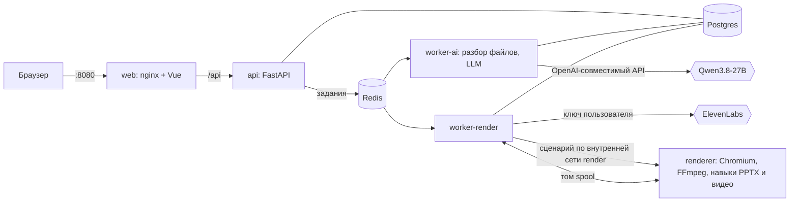

# Генератор презентаций и роликов

Веб-сервис, который с помощью ИИ превращает текст и документы (.docx, .xlsx, .pptx, текст) в презентацию PPTX для правления или объясняющий ролик MP4 на HyperFrames. Пользователь загружает материалы, проверяет и правит сценарий, получает файл; история запусков и прогресс — в интерфейсе.

Результаты на материалах заказчика — в [`demo/`](demo/README.md): отчёт для правления (PPTX и превью слайдов), ролик «Что такое Суперсервис» (MP4 и сценарий по сценам), приёмка по шагам задания с замерами.

## Запуск

```bash
cp .env.example .env      # впишите LLM_API_KEY (ключ OpenRouter)
docker compose up -d      # первая сборка образов ~8 минут, дальше — секунды
```

Откройте http://localhost:8080.

Зарегистрируйтесь (любой email, пароль от 10 символов) и создайте проект: «Отчёт для правления» или «Ролик». Порт меняется `WEB_PORT`. Озвучка ролика включается, если пользователь добавит свой ключ ElevenLabs в «Настройках»; без ключа ролик собирается без звука, с субтитрами.

## Как это устроено



| Сервис | Что делает |
|---|---|
| `web` | nginx: интерфейс на Vue 3 и прокси `/api` на том же адресе; единственный опубликованный порт, лимиты тела запроса и частоты |
| `api` | FastAPI: вход, проекты, загрузки, сценарии, запуск заданий, файлы; проверка владельца каждого ресурса |
| `worker-ai` | «ИИ-модуль»: разбор файлов, очистка данных, обращение к модели, проверка сценария (очередь `ai`, 5 одновременно) |
| `worker-render` | сборка: сценарий → озвучка (если есть ключ) → вызов `renderer` → файлы в хранилище (очередь `render`, 2 одновременно) |
| `renderer` | песочница с headless Chromium, FFmpeg и навыками `pptx-builder` / `video-builder`: без секретов, в сети без выхода наружу |
| `postgres`, `redis`, `migrate` | данные и история; брокер очереди; миграции Alembic перед стартом API |

**Путь отчёта.** Файлы проверяются по содержимому (не по расширению), из таблиц код извлекает очищенные факты с адресами ячеек и сообщает, что исправил (число текстом, «нет данных», сверка итогов). Модель одним обращением пишет сценарий в JSON: выбирает типы слайдов и тексты, а **числа не пишет** — она ссылается на факты (`{completion[Урал]}`) и объявляет расчёты из фиксированного набора операций (разница, доля, процент изменения…). Код проверяет сценарий — схему, ссылки, расчёты, цитаты из документов, слова рядом с числами — и при ошибках возвращает модели их список (до трёх попыток). Пользователь правит сценарий формой по типу слайда; правка проходит те же проверки. Сборка: навык верстает каждый слайд в HTML/CSS в Chromium, измеряет элементы и создаёт в python-pptx **нативные** объекты — текст, таблицы и графики с данными остаются редактируемыми.

**Путь ролика.** Модель выбирает для каждой сцены один из семи шаблонов (заголовок, тезис, список, крупная цифра, сравнение, шаги, финал) и пишет текст диктора; все числа сверяются с исходным текстом, длительности сцен подгоняет код. HTML и анимацию пишут **наши шаблоны**, а не модель: тексты только экранируются в готовую разметку, страница закрыта CSP. HyperFrames покадрово снимает таймлайн GSAP в Chromium, FFmpeg кодирует. С ключом ElevenLabs у каждой сцены свой голосовой клип, субтитры идут за голосом по разметке времени, добавляются тихая музыка и звук перехода, громкость выравнивается до −16 LUFS.

## Смена модели и ключа

Всё — переменные окружения, без пересборки образов:

```bash
# в .env: LLM_BASE_URL, LLM_MODEL, LLM_API_KEY, LLM_EXTRA_BODY
docker compose up -d      # пересоздаст только сервисы с изменёнными настройками
```

Для vLLM/SGLang в контуре заказчика: `LLM_BASE_URL=http://<сервер>/v1`, `LLM_MODEL=<имя модели на сервере>`, `LLM_EXTRA_BODY={"chat_template_kwargs":{"enable_thinking":false}}`. Проверено (шаг 6 приёмки): смена модели — перезапуск `worker-ai` за 2 с, и следующий сценарий пишет уже новая модель. Ключ ElevenLabs у каждого пользователя свой: вводится в «Настройках», хранится зашифрованным (`SECRETS_KEY`, см. `.env.example`), в ответы API и логи не попадает.

## Как добавить тему оформления или тип слайда

- **Тема проекта** — `brand.json` в шаге «Материалы и оформление» (вставить JSON) плюс логотип PNG. Формат как у заказчика: `colors.primary` обязателен, `accent`, `text`, `background`, `positive`, `negative` и др. — по желанию, `fonts.heading` / `fonts.body`. Недостающие оттенки сервис смешивает из заданных и предупреждает о слабом контрасте; тема применяется и к PPTX, и к ролику.
- **Тема по умолчанию** — `DEFAULT_THEME` в [`backend/app/brand.py`](backend/app/brand.py) (9 цветов и два шрифта).
- **Новый шрифт** — установить его в образ `render` (`backend/Dockerfile`) и, если нужен запасной с теми же метриками, вписать пару в [`skills/pptx-builder/fonts/substitutes.json`](skills/pptx-builder/fonts/substitutes.json).
- **Новый тип слайда** — шаблон в `skills/pptx-builder/src/templates/` и строка в `index.ts`; описание полей в `backend/app/scenario/deck.py` (что пишет модель) и `render.py` (что получает навык); метод разрешения ссылок в `resolve.py`; строка в промпте `backend/app/agent/prompts.py`. Новый шаблон сцены ролика — `sceneBody` в `skills/video-builder/src/composition.ts` и тип в `backend/app/scenario/video.py`.

## Скорость

Замер на приёмке (чистая база, MacBook на Apple Silicon, Docker Desktop), время от нажатия «Создать» до готового файла, без времени пользователя на проверку сценария:

| | Разбор файлов | Модель | Рендер | Итого |
|---|---|---|---|---|
| Презентация, 10 слайдов в настройках (вышло 9) | 0,03 с | 10,9 с (3 обращения) | 2,6 с | ≈ 15 с |
| Ролик 75 с, 7 сцен, без голоса | < 0,01 с | 22,5 с (2 обращения) | 49,6 с (запись 48,8 с, кадры 0,8 с) | ≈ 74 с |
| Голос, если есть ключ | | | + 19,8 с на 7 клипов (818 символов, по 2 параллельно), выравнивание громкости 3,3 с; повторная сборка — 0,02 с из кеша | рендер с голосом ≈ 115 с |

Что ускорено:
- **Порядок провайдеров OpenRouter.** Одна и та же Qwen3.8-27B у разных хостов работает со скоростью от 11 до 206 токенов в секунду. Сценарий презентации — около 3 800 токенов ответа: по умолчанию 66–100 с на обращение, с быстрыми провайдерами — 2–6 с.
- **Рассуждения модели выключены.** Сценарий пишется одним обращением, без пошагового вызова функций.
- **Арифметику делает код.** Числа, итоги и длительности сцен считает код, поэтому модель не тратит на них попытки. Если «шлифовка» сломала уже корректный сценарий, лишнее обращение не делается.
- **Покадровая съёмка ролика.** На Linux HyperFrames снимает кадры через BeginFrame (75 с видео за 49 с; на macOS вне Docker — 103 с). Полоса прогресса шагает по сценам, поэтому одинаковые кадры не снимаются заново.
- **Клипы озвучки.** Кешируются по тексту: повторная сборка не тратит ни время, ни кредиты.

Узкие места:
- **Обращение к модели.** Здесь главная переменная — скорость хоста; в контуре заказчика это его GPU.
- **Запись ролика.** Занимает примерно 0,65 от длины видео.

## Безопасность

- **Загрузки.** Тип файла определяется по содержимому. Ограничены размер (20 МБ, nginx отсекает больше ещё до API) и число файлов. Есть защита от zip-бомб и обхода путей: архив проверяется до распаковки, файлы на диске названы по id. Макросы вырезаются и не выполняются.
- **Недоверенное содержимое.** Указания модели внутри документов удаляются кодом до вызова и показываются пользователю. Промпт отделяет данные от инструкций. Числа на слайдах берутся только из данных.
- **Сгенерированный HTML.** Модель HTML не пишет. Chromium работает только в контейнере `renderer`: без паролей и ключей, без выхода в интернет, без доступа к базе и Redis. Файлы из него воркер читает без перехода по ссылкам.
- **Секреты и доступы.**
  - Ключи берутся только из переменных окружения; ключ пользователя хранится зашифрованным и привязан к владельцу.
  - Контейнеры работают не от root, с файловой системой только для чтения и `cap_drop: ALL`.
  - Сессии серверные, с HttpOnly-cookie, плюс защита от CSRF.
  - Частота запросов ограничена в nginx и в приложении; квоты проверяются под блокировкой.
  - Владелец проверяется у каждого ресурса.
- **Код.**
  - Модули по ответственности.
  - Типы: mypy strict, TypeScript strict.
  - Миграции Alembic, линтеры ruff, eslint и prettier.
  - 431 тест: backend 361, навык PPTX 34, навык видео 12, интерфейс 24.

Подробности — в журнале решений, строки 8, 18–25, 30–31, 41, 43–44.

## Журнал решений (кратко)

Полный журнал с альтернативами и причинами — [docs/decisions.md](docs/decisions.md) (53 решения), допущения — [ASSUMPTIONS.md](ASSUMPTIONS.md).

| Решение | Почему |
|---|---|
| LLM для теста — `qwen/qwen3.8-27b` через OpenRouter, рассуждения выключены, быстрые провайдеры первыми | Та же модель, что в контуре заказчика: качество на тесте отражает прод; скорость хостов отличается в 18 раз |
| Числа считает код, модель ссылается на факты (`{имя}`) и фиксированные операции | Каждая цифра прослеживается до ячейки Excel; выдуманное число не проходит проверку |
| Один вызов пишет весь сценарий, код проверяет и возвращает ошибки (до 3 попыток) | Вызов функций и структурированный вывод у Qwen не описаны; так работает любой OpenAI-совместимый сервер |
| Подписи сверяются с числами: знак и слово направления, период KPI, итог таблицы, масштаб единиц | Все ошибки этого рода найдены в живых прогонах: настоящая ячейка с чужой подписью |
| Указания в документах удаляются до модели и показываются пользователю | Промпт отбивал грубые атаки, но правдоподобное «примечание редактора» проходило |
| PPTX: вёрстка в HTML/CSS в Chromium → измерение → нативные объекты python-pptx | Переносы и подгонку текста делает браузер, превью совпадает с файлом, графики редактируемые (у PptxGenJS в Keynote пустые) |
| Ролик: HyperFrames + наши шаблоны сцен, модель выбирает тип и пишет текст | В браузере рендера нет кода от модели; одинаковый сценарий даёт одинаковый ролик |
| Chromium только в контейнере `renderer` без секретов и сети; результаты читаются без перехода по ссылкам | Что бы ни сделала страница, ей нечего украсть и некуда отправить |
| Celery + Redis, две очереди; состояние заданий — в Postgres с номером попытки и пульсом | LLM (ожидание) и рендер (процессор) масштабируются отдельно; задачи переживают перезапуски |
| Сессии на сервере, CSRF-заголовок, лимиты в nginx и в приложении, квоты под блокировкой | Выход отзывает сессию сразу; параллельные загрузки не пробивают лимиты (проверено тестом) |
| Голос — ElevenLabs v4 напрямую, ключ пользователя в Fernet | Сравнение с Gemini 3.8 Flash TTS на одной фразе: оба точны, ElevenLabs быстрее и даёт время каждого символа для субтитров |
| Длительности сцен и подгонку под голос делает код | Модель повторяла сценарий на 79 с из раза в раз; код укладывает в 60–75 с без лишних вызовов |
| Число слайдов из настроек — пожелание с предупреждением | Корректная презентация на слайд короче лучше упавшей задачи |
| Интерфейс: Vue 3, правка формой по типу слайда, числа — «фишками» из данных | Пользователь правит текст, а не JSON, и не может вписать цифру не из данных |
| Статус — опрос раз в секунду | Задачи длятся секунды и минуты, статус и так в базе; без отдельной инфраструктуры |

## Что не успели и что дальше

- **PPTX с вшитым видео** (желательный пункт 10) — не сделан.
- **Перегенерация одного слайда или сцены моделью** (пункт 11). Не сделана. Можно править сценарий и пересобрать; при этом заново озвучиваются только изменённые сцены. Следующий шаг — запрос к модели «перепиши слайд N» с той же проверкой.
- **Значки и схемы в сценах ролика.** Сцены-тезисы пока показывают только заголовок. Следующий шаг — набор иконок и шаблон «схема из 3 элементов».
- **Трактовки модели не проверяются.** Например, «малые филиалы показывают худшие метрики». Цифры, знаки, периоды и итоги проверяются, а трактовка видна пользователю на шаге проверки.
- **Нагрузочный прогон «5 генераций одновременно».** Очереди на это рассчитаны, но прогона не было.
- **Отдельный контейнер `renderer` на каждое задание** (сейчас два задания делят один) и мониторинг (метрики, трассировка).
- **Ссылка как источник для ролика** («по желанию» в брифе).

## Разработка

```bash
cd backend && uv sync && uv run ruff check . && uv run mypy && uv run pytest
cd frontend && npm ci && npm run lint && npm run typecheck && npm test
cd skills/pptx-builder && npm ci && npm test && uv run pytest     # нужен CHROMIUM_PATH
cd skills/video-builder && npm ci && npm test
```

## Где использовался ИИ-ассистент

Код написан вместе с Claude Code (Anthropic) по модулям: навык PPTX → разбор файлов и факты → сценарий и агент → данные, вход и задания → интерфейс → песочница рендера и видео → озвучка → приёмка. Каждый модуль начинался с обсуждения вариантов (они в журнале решений) и заканчивался ревью и живым прогоном. Проверки на живых прогонах:
- цифры на слайдах демо-отчёта сверены с `q3_metrics.xlsx`;
- превью слайдов и кадры ролика просмотрены;
- графики PPTX открыты в Keynote;
- факты ролика сверены с текстом раздела;
- атаки через документы (6 вариантов) прогнаны против живой модели;
- приёмка по шагам задания выполнена на чистом клоне.

Каждая найденная ошибка закреплена тестом.
